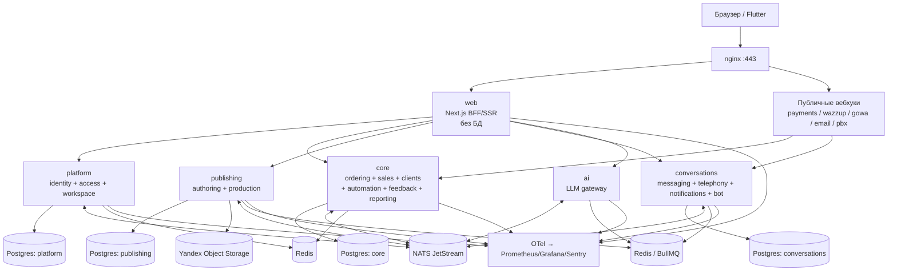

# 02. Целевая архитектура

> **2026-11-05: направление изменено.** Ближайшая цель — модульный монолит + отдельные процессы
> (`mybook-worker` для фона, PDF — в потоке с лимитом памяти) и быстрый CI, без микросервисов и без смены языка:
> [ADR 0009](adr/0009-modular-monolith-with-workers.md). Ниже — target A, он остаётся справкой и
> вариантом на случай триггеров из ADR 0009 §5.

> Решения зафиксированы в ADR: [топология](adr/0001-target-topology.md),
> [вынос бэкенда](adr/0002-backend-extraction-strategy.md),
> [данные](adr/0003-data-ownership.md), [события/очереди](adr/0004-events-jobs-cache.md),
> [поиск](adr/0005-search.md), [auth](adr/0006-auth.md).

## 1. Принципы

1. **Не менять пользовательский опыт.** UI, URL, тексты, cookie и ответы API остаются прежними.
   Меняется только то, откуда сервер берёт данные.
2. **Сначала граница деплоя, потом граница сервиса.** Сначала бэкенд целиком становится отдельным
   процессом. Только потом режем его по доменам.
3. **Данные принадлежат одному сервису.** Другой сервис читает их через API или проекцию, но не
   через `JOIN` и не через чужую таблицу.
4. **Синхронно — только чтение.** Записи между сервисами — события, саги, идемпотентные команды.
   Распределённых транзакций нет.
5. **Outbox остаётся.** Postgres-outbox — источник истины; NATS — транспорт. Потеря сообщения при
   падении процесса недопустима.
6. **Сначала контракт, потом код.** OpenAPI/схема события и тест — раньше реализации.
7. **Флаги и тени.** Любой переезд включается флагом; parity-режим сравнивает старый и новый путь.
8. **Никакой инфраструктуры «на всякий случай».** Каждая технология — с обоснованием и ADR.

## 2. Target A (рекомендуемый): 6 деплойментов + edge



### 2.1. Сервисы

| Сервис | Контексты | Ответственность | Почему отдельно | Волна |
|---|---|---|---|---|
| **web** | UI, SSR, BFF | Страницы, компоненты, server actions, сессионная cookie, композиция данных для экранов | Деплой UI независимо; в `web` нет `pg`/`drizzle`/модулей | 1 |
| **platform** | identity, access, workspace | Вход, сессии, 2FA, сотрудники, роли/права, настройки интеграций, свои поля, шаблоны, push, live | Security boundary и общие настройки для всех | 4 |
| **core** | ordering, sales, clients, automation, feedback, referrals, marketing, reporting | Заказы, оплата, сделки, клиенты, задачи, правила, отзывы, отчёты | Пока держим вместе: общие транзакции «заказ ↔ сделка ↔ счёт», общий `reporting`. Временный модульный монолит | 1 (как `api`) |
| **publishing** | authoring, production | Книги, вопросы, фото, письма, вёрстка, PDF, превью, файлы для типографии | Тяжёлый CPU/RAM; изоляция падений рендера | 2 |
| **conversations** | messaging, telephony, notifications | WhatsApp/Instagram/Telegram, почта, веб-чат, звонки, бот, письма-уведомления | Долгие соединения, вебхуки, ретраи, внешние сбои | 3 |
| **ai** | assistant | LLM-провайдеры, промпты, маршрутизация, стоимость, лимиты | Ключи/квоты/таймауты в одном месте; не роняет заказы | 5 |
| **insights** | reporting, search | Read-модели, поиск, аналитика | Только когда `core` станет узким местом | 6 (опция) |

`core` на волне 1 — это **тот же код**, что сегодня в `src/modules`, но за HTTP. Он не считается
«финальным» сервисом: его задача — убрать БД из `web` с минимальным риском. Разделение `core` на
`commerce` и `crm` — отдельная волна 6, только при наличии причин.

### 2.2. Context → service

| Контекст | Сервис A | Сервис B (если делим `core`) |
|---|---|---|
| identity | platform | platform |
| access | platform | platform |
| workspace | platform | platform |
| ordering | core | commerce |
| referrals | core | commerce |
| marketing | core | commerce (или crm, по владельцу отчёта) |
| sales | core | crm |
| clients | core | crm |
| automation | core | crm |
| feedback | core | crm |
| reporting | core | insights |
| authoring | publishing | publishing |
| production | publishing | publishing |
| messaging | conversations | conversations |
| telephony | conversations | conversations |
| notifications | conversations | conversations |
| assistant | ai | ai |

## 3. Target B (полный): 8 деплойментов

Появляется, только если после волны 5 есть ответ на вопрос «зачем»:

- **commerce** — заказы, оплата, счёта, промокоды, сертификаты, рефералы. Причина: деньги и
  вебхуки требуют отдельного релизного цикла и аудита.
- **crm** — сделки, клиенты, задачи, автоматизации, отзывы. Причина: высокая частота изменений,
  отдельная команда/подрядчик.
- **insights** — отчёты и поиск. Причина: read-нагрузка и другой профиль масштабирования.

Что должно быть готово до B:

1. Сняты **все** внешние ключи между `commerce` и `crm` (сейчас 5+).
2. Саги: `order_placed → deal_created`, `payment_received → deal_payment + invoice_paid`,
   `deal_won → invoice`, `referral_reward`. Есть таблица процесса, компенсации, идемпотентность.
3. Сверка денег: ежедневный отчёт «сумма платежей = сумма в сделках = сумма в заказах» с алертом.
4. Read-модель отчётов: проекции из событий или отдельная БД, а не `JOIN` по чужим схемам.
5. Нагрузочный профиль: `core` действительно упирается в CPU/память/релизы.

Без этого B — это распределённый монолит с двумя базами и боли по консистентности.

## 4. Данные: кто чем владеет

### 4.1. Target A

| Сервис | Схема | Таблицы |
|---|---|---|
| **platform** | `platform` | `users`, `sessions`, `password_resets`, `crm_roles`, `crm_audit`, `crm_settings`, `crm_fields`, `crm_templates`, `crm_notifications`, `crm_mobile_devices`, `crm_pinned_chats`, `crm_push_subscriptions` |
| **core** | `core` | `orders`, `order_payments`, `promo_codes`, `gift_cards`, `payment_invoices`, `order_events`, `referral_rewards`, `crm_links`, `crm_link_clicks`, `marketing_spend`, `crm_pipelines`, `crm_stages`, `crm_deals`, `crm_payments`, `deal_invoices`, `crm_receipts`, `crm_stage_history`, `crm_saved_views`, `crm_plans`, `crm_notes`, `crm_tasks`, `crm_automations`, `crm_automation_runs`, `reviews`, `outbox_events` |
| **publishing** | `publishing` | `books`, `book_questions`, `book_chapters`, `photos`, `photo_edits`, `book_letters`, `design_ai_requests`, `design_ai_credits`, `design_ai_purchases`, `answer_files`, `answer_file_purchases` |
| **conversations** | `conversations` | `crm_conversations`, `crm_messages`, `crm_bot_events`, `crm_blocklist`, `crm_calls`, `email_log` |
| **ai** | `ai` | новые: `ai_usage`, `ai_cost`, `ai_cache` (по мере появления) |
| **web** | — | нет БД; только cookie сессии |

> `design_ai_credits` / `design_ai_purchases` — деньги. На волне 2 они остаются в publishing,
> на волне 6 могут переехать в commerce. Это записано как открытый вопрос, не как факт.

### 4.2. Правила владения

1. **Одна таблица — один владелец.** Другие сервисы не делают `SELECT` из неё.
2. **Ссылки — идентификаторы без FK.** `user_id`, `order_id`, `deal_id`, `book_id` хранятся как
   значения; целостность обеспечивают события и сверки, а не база.
3. **Схема на сервис — сначала в одной БД.** `ALTER TABLE ... SET SCHEMA` позволяет переехать без
   дампа/восстановления. Физическое разделение — после снятия FK.
4. **Миграции — у владельца.** `apps/api`/service владеет своей папкой миграций; `web` миграций не
   имеет. Общая миграция, меняющая две схемы, запрещена.
5. **Отчёты — только чтение.** `reporting` не пишет; когда выносится в `insights`, получает
   собственные read-модели и не ходит в чужие таблицы.

### 4.3. Как снимать FK

Порядок для каждой связи (expand → migrate → contract):

1. Добавить колонку-идентификатор без FK (если её нет), бэкфилл.
2. Переключить код на новую колонку; старую оставить на один релиз.
3. Удалить FK-констрейнт, затем старую колонку.
4. Добавить тест, что сервис не импортирует чужую схему/таблицу.

Пример: `sales.crm_deals.user_id → identity.users.id`. После platform: `crm_deals.user_id` остаётся
`uuid`, FK удаляется, имя/телефон сотрудника приходят из platform API или кэша.

## 5. Синхронное и асинхронное

### 5.1. Когда HTTP

- BFF → сервис: чтение для страницы, команда, на которую нужен немедленный ответ пользователю.
- Сервис → сервис: **только чтение** (получить книгу, клиента, настройку) с таймаутом 300–1000 мс,
  кэшем и fallback.
- Публичные вебхуки: HTTP, подпись, идемпотентность.

### 5.2. Когда событие

- Любой факт, который уже произошёл: `order.paid`, `deal.stage_changed`, `book.ready`,
  `message.received`, `payment.confirmed`.
- Всё, что не влияет на ответ пользователю прямо сейчас.
- Всё, что сегодня уже идёт через `outbox_events` и `subscriptions.ts`.

### 5.3. Саги (только после волны 6)

| Сага | Шаги | Компенсация |
|---|---|---|
| Оформление заказа | order created → deal created → task assigned | отменить сделку/задачу или пометить «осиротевшей» |
| Оплата заказа | payment confirmed → order paid → deal payment → invoice paid → receipt | вернуть платёж, сторно, заметка «нужен возврат» |
| Счёт из чата | invoice paid → access granted → message sent | отозвать доступ, уведомить |
| Реферал | order paid → reward issued | отменить награду, если заказ отменён до выпуска |

Правило: **никаких `BEGIN` через два сервиса**. Только локальная транзакция + outbox.

### 5.4. Идемпотентность

- `Idempotency-Key` на всех публичных POST, создающих деньги/сообщения/заказы.
- Таблица `processed_requests` или Redis с TTL 24 ч.
- События: `event.id` + `consumer` в inbox-таблице; повтор не применяет эффект дважды.
- Вебхуки: `provider_event_id` уникален.
- Outbox: `FOR UPDATE SKIP LOCKED`, как сейчас; подписчик помечается доставленным.

## 6. Аутентификация и авторизация

### 6.1. Что сохраняем

- Cookie `mb_session` (httpOnly, sameSite=lax, secure на https) — браузер и Flutter Bearer-токен.
- Тот же вход, 2FA, сброс пароля, права сотрудников, IP-allowlist, обязательная 2FA.
- Те же тексты ошибок и редиректы.

### 6.2. Как ходим между сервисами

1. `web` получает cookie.
2. `web` → `platform` `POST /internal/v1/session/introspect` с cookie/Bearer.
3. `platform` возвращает `UserContext`: `userId`, `role`, `staff`, `permissions`, `securityPassed`,
   `sessionId`, `expiresAt`.
4. `web`/сервис получает короткоживущий **internal JWT** (EdDSA, 60 с, `aud` = сервис, scopes) от
   platform или подписывает его сам ключом, который знает platform. JWT кэшируется в Redis на 30–60 с
   по хешу сессии.
5. Сервис проверяет JWT по JWKS platform; для публичных вебхуков — подпись провайдера.

Почему не «каждый сервис читает `sessions`»: это связывает все сервисы с таблицей platform и
исключает независимую БД. Почему не Keycloak: миграция пользователей/2FA/прав дороже, а UX надо
сохранить.

### 6.3. Внутренняя сеть

- Все сервисы слушают `127.0.0.1` (или приватную сеть). Наружу nginx отдаёт только `web` и
  перечисленные вебхуки.
- `X-Internal-Token` (HMAC от тела + timestamp) для service-to-service, чтобы случайный локальный
  процесс не мог командовать.
- При переезде на несколько машин — mTLS; это отдельный ADR.

## 7. API-контракты

- **Публичные URL не меняются.** `/api/mobile/*`, `/api/books/*`, `/api/admin/*` и т.д. остаются
  теми же: nginx маршрутизирует их к владельцу. Клиентский код не переписывается.
- **Internal API** — `/internal/v1/*`, наружу не проксируется.
- **OpenAPI 3.1** генерируется из Zod (`fastify-type-provider-zod` / `zod-to-openapi`), клиент —
  `openapi-typescript` + `openapi-fetch`.
- **Ошибки** — единый конверт: `{ error, code, params?, requestId }`; HTTP-статус по реестру
  `domainStatus` (сохранить существующий).
- **Версии** — `/v1` в URL для публичного API, `.v1` в типе события. Ломающие изменения — только
  новый мажор с периодом двойной поддержки.
- **Пагинация** — cursor (`limit`, `cursor`) для списков; не offset на больших таблицах.
- **Идемпотентность** — заголовок + TTL; для вебхуков — ID события провайдера.
- **Таймауты/ретраи** — только идемпотентные GET; POST не ретраится автоматически без ключа.
- **Contract tests** — каждый сервис проверяет, что его ответы соответствуют OpenAPI; BFF — что
  DTO совпадают с golden-снимками.

Подробно — [05-contracts-and-parity.md](05-contracts-and-parity.md).

## 8. Файлы и объектное хранилище

Сейчас: локальный `storage/` на одном томе, общий для веба и PDF. При нескольких сервисах это
превращается в «все видят один диск» и мешает вынести worker.

Target: **Yandex Object Storage**, бакет `mybooks` (S3 API, endpoint `https://storage.yandexcloud.net`,
region `ru-central1`). Ключи — вне репозитория; локально — профиль `yc-storage` и `S3_*` в
`.env.local`. MinIO допускается только для локальных тестов. Подробно — [07-storage-s3.md](07-storage-s3.md).
- Ключи: `books/<bookId>/...`, `photos/<bookId>/<photoId>.<ext>`, `pdf/<bookId>/<version>/...`,
  `receipts/<...>`, `publish/<...>`.
- Метаданные — в БД владельца; объект — по ключу.
- Доступ: подписанные URL с TTL; внутренние сервисы — S3 credentials из env.
- Жизненный цикл: превью удаляются, оригиналы и печатные PDF — по политике; бэкап — версионирование
  бакета + ежедневный snapshot.
- Миграция: скрипт копирует `storage/` в бакет, ключи не меняются, затем переключение чтения.

## 9. Поиск

Сейчас `reporting/Search.ts` — `ILIKE` по нескольким таблицам. Для текущего объёма этого достаточно.

| Этап | Решение | Когда |
|---|---|---|
| Сейчас | Postgres FTS (`tsvector`) + `pg_trgm` + индексы | Волна 1–5 |
| Если нужен поиск с опечатками/релевантностью | Meilisearch (индекс из событий) | Волна 6, при жалобах на поиск |
| Если нужен поиск по логам/аналитика на десятки миллионов документов | OpenSearch | Только после отдельного ADR и с бюджетом RAM |
| Elasticsearch | Не используем | Дублирует OpenSearch, тяжелее в эксплуатации |

Почему не Elasticsearch сейчас: 8 ГБ на всё, из них PDF до 1.5 ГБ. JVM-кластер ES — это минимум
1–2 ГБ только под поиск, плюс обслуживание. У нас 54 таблицы и сотни тысяч строк — Postgres
справляется.

## 10. Наблюдаемость

Без неё распределённый бэкенд нельзя эксплуатировать.

- **Трассировка**: OpenTelemetry, W3C `traceparent`, один trace на запрос пользователя через BFF и
  сервисы; `requestId` в логах и ошибках.
- **Логи**: pino JSON, без PII/секретов, уровень по env, корреляция с trace.
- **Метрики**: RED (rate/errors/duration) по каждому маршруту; очередь BullMQ (waiting/active/failed/
  delayed); outbox lag; PDF duration/peak RSS; платежи (success/fail); сообщения (delivered/failed);
  LLM (latency/tokens/cost).
- **Алерты**: 5xx > 1% 5 мин; p95 > 2× baseline; outbox pending > 100 или oldest > 5 мин; очередь
  render failed > 0; платёж не подтверждён > 10 мин; сервис down.
- **Дашборды**: «Заказы и деньги», «Сообщения», «PDF», «Инфраструктура», «LLM».
- **Sentry** — ошибки фронта и сервисов, с release/commit.

## 11. Деплой и сеть

### 11.1. Target A на одном хосте

```
nginx :443
  /                 → web:3040
  /api/books/...    → publishing:3065   (3060/3061 на сервере заняты Daiyn)
  /api/payments/... → core:3050
  /api/integrations/... → conversations:3070
  /api/...          → core:3050 (пока)
  /internal/*       → deny (наружу)
```

- Все сервисы — PM2 (сейчас) или Docker Compose (позже).
- `web` и `core` — два релиза в одном артефакте; публикация — отдельный; conversations — отдельный.
- Релизный манифест: версии сервисов, commit, миграции.
- Порядок: миграции владельца → новый процесс на временном порту → smoke → переключение nginx/PM2 →
  проверка → откат при ошибке.
- Health: `/health` (liveness) и `/ready` (БД/Redis/зависимости).

### 11.2. Память

| Компонент | Оценка RSS |
|---|---:|
| web (Next standalone) | 500–700 МБ |
| core (Next/Fastify + Drizzle) | 600–900 МБ |
| platform | 200–300 МБ |
| publishing API | 250–350 МБ |
| render-worker (пик PDF) | 1000–1600 МБ |
| conversations | 300–450 МБ |
| ai | 200–300 МБ |
| Redis | 128 МБ |
| NATS | 128 МБ |
| Postgres (shared buffers + connections) | 800–1200 МБ |
| ОС + прочее | ~1000 МБ |
| **Итого** | **~5.1–7.1 ГБ** |

> В таблице только MyBooks. На том же сервере живут DoseWear, my-test, Daiyn, kaspi-pos и GOWA
> (~3 ГБ занято без нагрузки), а мониторинг (Prometheus/Grafana/OTel collector) не учтён. См.
> [09-review-2026-11-05.md](09-review-2026-11-05.md).

На 8 ГБ с чужими проектами это впритык. До волны 3 нужно одно из:

- +4–8 ГБ RAM на сервере;
- вторая машина под publishing/render;
- ограничение PDF-воркера (`PDF_CONCURRENCY=1`, `max_memory_restart`, cgroup). S3 уже внешний —
  MinIO на хосте не занимает память.

Это решение фиксируется в PROGRESS как блокер, а не «потом разберёмся».

## 12. Чего в target нет

- Микрофронтендов и переписывания UI.
- Отдельной БД на каждый сервис в первый день.
- Kafka, RabbitMQ, Elasticsearch, Kubernetes, service mesh.
- GraphQL/gRPC.
- Keycloak/внешнего OIDC.
- 15+ сервисов «по одному на контекст».
- Распределённых транзакций и синхронных цепочек записи.

## 13. Открытые вопросы

| # | Вопрос | Когда решить | Владелец |
|---|---|---|---|
| Q1 | 8 ГБ хватит или добавляем RAM/второй хост? | до волны 2 | пользователь |
| Q2 | S3: **решено** — Yandex Object Storage, бакет `mybooks`; доступ ждёт проверки ключей | — | пользователь |
| Q3 | `core` делим на commerce/crm или оставляем? | после волны 5 | архитектор |
| Q4 | `design_ai_credits` — publishing или commerce? | волна 6 | архитектор |
| Q5 | Нужен ли `insights` или отчёты остаются в core? | волна 6 | продукт |
| Q6 | Монорепо npm workspaces или pnpm? | волна 0 | архитектор |
| Q7 | Деплой: PM2 или Docker Compose? | волна 1 | infra |
